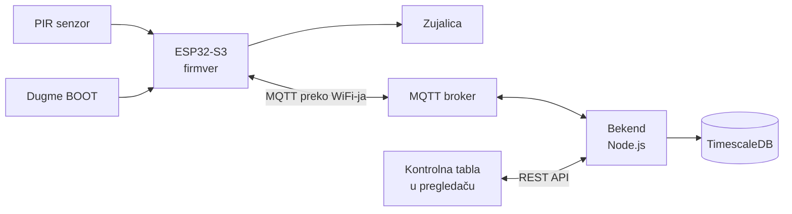
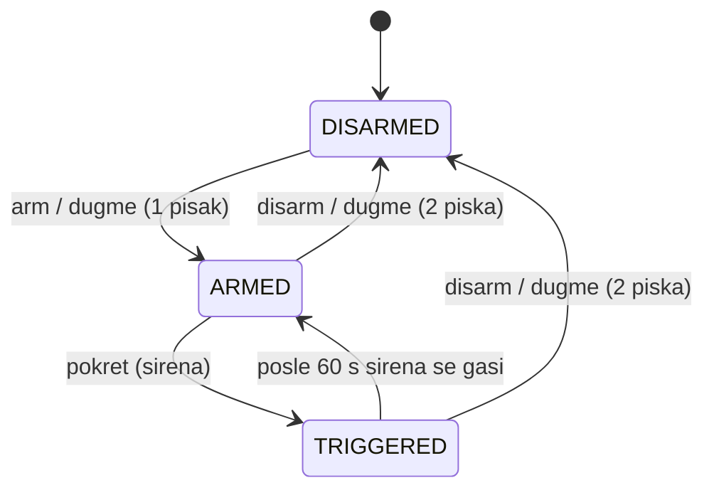

# Pametni kućni alarm

Dokumentacija u PDF formatu: [docs/Dokumentacija_pametni_alarm.pdf](docs/Dokumentacija_pametni_alarm.pdf)

Projekat iz predmeta Internet stvari. Uređaj sa ESP32-S3 mikrokontrolerom otkriva neovlašćeni ulazak pomoću PIR senzora i uključuje sirenu (zujalicu). Događaje šalje serveru preko MQTT-a. Server ih čuva u bazi vremenskih serija, a veb kontrolna tabla prikazuje stanje alarma i istoriju događaja i omogućava uključivanje i isključivanje alarma.

## Arhitektura



| Deo | Tehnologija |
|---|---|
| Uređaj | ESP32-S3, PIR senzor HC-SR501, modul zujalice |
| Firmver | C, ESP-IDF v5.5.6, FreeRTOS |
| Komunikacija | WiFi, MQTT, JSON |
| Server | Docker Compose: Eclipse Mosquitto, Node.js (Express), TimescaleDB (PostgreSQL 16) |
| Korisnički interfejs | HTML, CSS, JavaScript, Chart.js |

## Hardver

| Komponenta | Pin komponente | Pin ESP32-S3 |
|---|---|---|
| PIR | VCC | 5V |
| PIR | OUT | GPIO4 |
| PIR | GND | GND |
| Zujalica | VCC | 3V3 |
| Zujalica | I/O | GPIO5 (zujalica se pali na LOW) |
| Zujalica | GND | GND |
| Dugme BOOT | – | GPIO0 (na ploči) |

Ploča: Waveshare ESP32-S3-DEV-KIT-N16R8 (16 MB flash, 8 MB PSRAM). Na PIR senzoru je potenciometar za vreme podešen na minimum (signal traje oko 3 s).

## Firmver

Firmver je podeljen na ESP-IDF komponente (folder `components/`). Komponente ne zavise jedna od druge, a `main/main.c` ih pokreće i povezuje.

| Komponenta | Uloga |
|---|---|
| `pir` | čitanje PIR senzora |
| `button` | čitanje dugmeta |
| `buzzer` | uključivanje i isključivanje zujalice (PWM ton od 2 kHz) |
| `alarm` | mašina stanja i sirena |
| `wifi_manager` | WiFi veza; podaci o mreži se čitaju iz NVS-a |
| `mqtt_service` | slanje događaja serveru i prijem komandi |

### FreeRTOS taskovi

- `sensor_task` (u `main.c`) – 10 puta u sekundi čita PIR i dugme i alarmu javlja samo početak pokreta, odnosno pritisak dugmeta.
- `alarm` – prima događaje iz FreeRTOS reda i sprovodi mašinu stanja. Dok traje alarm, budi se svakih 400 ms i naizmenično pali i gasi zujalicu.

### Mašina stanja



- Pokret dok je alarm isključen se ignoriše i ne šalje se serveru.
- Na server se šalje samo pokret detektovan dok je alarm uključen i promene stanja.
- Alarm radi i bez mreže: sirena se pali na samom uređaju.

### WiFi i NVS

Pri prvom pokretanju uređaj upisuje podrazumevani SSID i lozinku iz menija **WiFi Manager** (menuconfig) u NVS. Posle toga ih uvek čita iz NVS-a. Za promenu mreže treba izmeniti meni, obrisati flash (`idf.py erase-flash`) i ponovo flešovati.

## MQTT teme

Teme imaju oblik `smart_alarm/<ID uređaja>/<vrsta>`; podrazumevani ID uređaja je `alarm-01`.

| Tema | Objavljuje | Pretplaćen | Primer poruke |
|---|---|---|---|
| `smart_alarm/alarm-01/events` | uređaj | bekend | `{"type":"motion","state":"ARMED"}` |
| `smart_alarm/alarm-01/status` | uređaj (retained), broker (Last Will) | bekend | `{"online":true,"state":"ARMED"}` |
| `smart_alarm/alarm-01/cmd` | bekend | uređaj | `{"cmd":"arm"}` ili `{"cmd":"disarm"}` |

- `events` – istorija: pokret dok je alarm uključen (`motion`) i svaka promena stanja (`state`).
- `status` – trenutno stanje. Poruka je *retained*, pa je broker pamti i šalje svakom novom pretplatniku. Ako uređaj nestane bez odjave, broker objavljuje njegovu *Last Will* poruku `{"online":false}`.
- Stanja: `DISARMED` (isključen), `ARMED` (uključen), `TRIGGERED` (alarm).

Broker, ID uređaja i početak tema podešavaju se u meniju **MQTT servis**.

## Server

Server se pokreće pomoću Docker Compose-a (folder `server/`) i ima tri servisa:

| Servis | Uloga |
|---|---|
| `mosquitto` | MQTT broker (port 1883) |
| `db` | TimescaleDB, baza vremenskih serija (port 5432) |
| `backend` | Node.js: prima MQTT poruke, upisuje ih u bazu, služi REST API i kontrolnu tablu (port 3000) |

### Baza

| Tabela | Sadržaj |
|---|---|
| `alarm_events` | svi događaji (vreme, uređaj, tip, stanje). TimescaleDB *hypertable* podeljena po danima. |
| `device_status` | poslednje stanje i online status svakog uređaja (jedan red po uređaju) |

Broj pokreta po satu računa se TimescaleDB funkcijom `time_bucket`.

### REST API

| Metoda i putanja | Opis |
|---|---|
| `GET /api/devices` | uređaji sa poslednjim stanjem i online statusom |
| `GET /api/devices/:id/events?limit=50` | poslednji događaji uređaja |
| `GET /api/devices/:id/stats/hourly?hours=24` | broj pokreta po satu |
| `POST /api/devices/:id/command` | komanda uređaju, telo `{"cmd":"arm"}` ili `{"cmd":"disarm"}` |

## Kontrolna tabla (prikaz telemetrije)

Kontrolna tabla je na adresi **http://localhost:3000** i osvežava se svakih 5 sekundi. Prikazuje:

- trenutno stanje alarma (Isključen / Uključen / ALARM) i da li je uređaj online,
- dugmad za uključivanje i isključivanje alarma,
- grafikon broja pokreta po satu za poslednja 24 sata,
- tabelu poslednjih događaja sa vremenom.

Šema povezivanja i snimak kontrolne table nalaze se u PDF dokumentaciji.

## Pokretanje

### Server

```bash
cd server
cp .env.example .env
docker compose up -d --build
```

Kontrolna tabla: http://localhost:3000. Gašenje: `docker compose down` (podaci u bazi ostaju sačuvani).

U `.env` fajlu je adresa MQTT brokera. Za pravu ploču na lokalnoj mreži koristi se lokalni Mosquitto (`mqtt://mosquitto:1883`), a za Wokwi simulaciju javni broker (`mqtt://broker.hivemq.com`), jer simulator ne vidi lokalnu mrežu.

### Firmver

Potrebni su ESP-IDF v5.5.6 i VS Code sa ESP-IDF ekstenzijom.

1. U menuconfig-u podesiti **WiFi Manager** (SSID i lozinka mreže od 2,4 GHz) i po potrebi **MQTT servis** (adresa brokera).
2. Prevesti i flešovati preko UART porta:

```bash
idf.py set-target esp32s3
idf.py build
idf.py -p COM4 flash monitor
```

### Simulacija (Wokwi)

Projekat se može pokrenuti i u simulatoru Wokwi (ekstenzija za VS Code). Šema simulacije je u `diagram.json`. U meniju **WiFi Manager** treba postaviti SSID `Wokwi-GUEST` bez lozinke, prevesti projekat i pokrenuti „Wokwi: Start Simulator“.

## Struktura repozitorijuma

```
components/        komponente firmvera (pir, button, buzzer, alarm, wifi_manager, mqtt_service)
main/              main.c: pokretanje i povezivanje komponenti, sensor_task
server/            docker-compose, Mosquitto, šema baze i bekend sa kontrolnom tablom
docs/              dokumentacija u PDF formatu
diagram.json       šema za Wokwi simulator
```

## Plan daljeg razvoja

- Odbrojavanje pri izlasku i ulasku i noćni režim po rasporedu
- Podešavanje WiFi mreže sa telefona preko Bluetooth-a (BLE provisioning)
- Obaveštenja e-mejlom pri alarmu i kada uređaj ode offline
